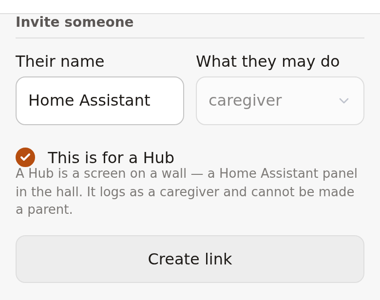

# Baby Log Book for Home Assistant

The Home Assistant integration for [Baby Log Book](https://github.com/derico-de/baby-log-book)
— a shared, offline-first log of a baby's day. It puts a Household's babies on a
wall panel: when the last feed was, whether a nap is running, how much milk went
in today, and six buttons plus two actions for the things a passing parent wants
to log without unlocking a phone.

**The app states when things are due; what your home does about it — a chime on
the hall speaker, a light that warms, nothing at all — is an automation you write
in Home Assistant, which is better at that than we will ever be.**

The integration talks to *your* deployment. There is no cloud in the middle: you
self-host Baby Log Book, paste a Claim Link into the config flow, and Home
Assistant becomes a **Hub** — a device with its own caregiver Member in the
Household, visible and revocable in the app's members list like any other.

## Install

HACS → Integrations → the three-dot menu → *Custom repositories* → this repo,
category *Integration*. Then **Settings → Devices & services → Add integration →
Baby Log Book**.

## Claim

A parent opens the app's **Settings**, sends an **Invite**, and ticks *this one is
for a Hub* — which fixes the role at caregiver, because a credential sitting on a
box in the hall should not be able to manage the Household.



Paste the whole link into the one field the config flow asks for. It looks the
link up first and shows you what it found; nothing is spent until you confirm.

Home Assistant then appears in the members list as `Home Assistant · Hub ·
caregiver`, and everything the panel logs is attributed to it — which is the
honest answer to *who pressed this*, because a button on a kitchen wall is
pressed by whoever is standing at it.

## Revoke

Remove the Hub's member in the app's Settings. It unplugs the panel: it stops
reading and writing at once, and everything it logged stays, with its name on it.

## Sign back in

If the panel says it has been signed out, a parent mints a **sign-in link** in
Settings — beside the pending invites, for this panel's member — and pastes it
into the dialog Home Assistant is showing. Same words, and the same procedure, as
a lost phone. Nobody else is signed out by it.

If the panel says its member has been **removed**, there is no signing back in:
removal burns those links. Send a fresh invite for a hub and add the integration
again.

## What you get

One device per baby, and one for the Household.

Per baby, seven instants:

| Entity | Reads |
| --- | --- |
| `sensor.<baby>_last_feed` | when the last feed started |
| `sensor.<baby>_feed_due` | when the next one is due |
| `sensor.<baby>_asleep_since` | when she went down |
| `sensor.<baby>_awake_since` | when she got up |
| `sensor.<baby>_wake_window_up` | when the wake window is up |
| `sensor.<baby>_bottle_life_runs_out` | when the open bottle stops being offerable |
| `sensor.<baby>_last_poop` | the last one, however far back |

Home Assistant renders all seven as *12 minutes ago* and *in 3 hours*, live and
in your language, for free. Use them as **triggers**.

Three flags — `binary_sensor.<baby>_asleep`, `_feeding`, `_bottle_open` — are the
**conditions**. Six daily totals — feeds, milk, sleep, tummy time, pees, poops —
reset at the Household's own day start rather than at midnight, so an 05:00
household gets an 05:00 day. Milk and tummy time appear the first time either is
ever logged, and never go away again.

On the Household device: `binary_sensor.<household>_caregiving`, and two
diagnostics — when the panel last heard the server, and how many presses are
still queued. Naming the Household is optional in the app, and one that has not
been named is called **Baby Log Book** here, because Home Assistant has to write
something on the device.

Six buttons per baby: *Sleep*, *She's awake*, *Feed*, *End feed*, *Tummy time*,
*Off her tummy*. A button goes unavailable where the app would put it away — no
*Sleep* while one is running — which is a convenience, not a rule. The rules are
the server's. Home Assistant greys an unavailable entity out rather than hiding
it; hide the tile too, if you want the wall quiet, with a `visibility` condition
on the card.

## A dashboard

Stock tile cards. Long compound names truncate on narrow tiles, so override the
name: the device name already says who she is.

```yaml
type: tile
entity: sensor.emma_wake_window_up
name: Wake window          # the device name already says "Emma"
```

## Two automations to copy

The lead time is yours, written in your trigger. The app never sends one.

```yaml
# Chime ten minutes before the bottle's life runs out.
triggers:
  - trigger: time
    at:
      entity_id: sensor.emma_bottle_life_runs_out
      offset: "-00:10:00"
conditions:
  - condition: state
    entity_id: binary_sensor.home_caregiving
    state: "on"
actions:
  - action: media_player.play_media
    target: { entity_id: media_player.hall }
    data: { media_content_id: "media-source://…", media_content_type: music }
```

```yaml
# Announce when a feed comes due.
triggers:
  - trigger: time
    at: sensor.emma_feed_due
conditions:
  - condition: state
    entity_id: binary_sensor.home_caregiving
    state: "on"
actions:
  - action: tts.speak
    target: { entity_id: tts.piper }
    data:
      media_player_entity_id: media_player.hall
      message: "Emma is due a feed."
```

Both carry the caregiving condition by default: **switch caregiving off in the app
while nobody is looking after her, and both of these go quiet.** That is how the
switch in the app reaches a wall.

## A one-press bottle button

A bottle takes an amount, so it is an action rather than a button — which is
exactly what a script is for.

```yaml
script:
  emma_120ml:
    alias: Emma — 120 ml
    sequence:
      - action: baby_log_book.log_bottle_feed
        target:
          device_id: abc123…          # the Baby's device, not a baby id
        data:
          volume_ml: 120
```

`baby_log_book.log_nappy` logs a pee, a poop or both the same way, with `pee`
and `poop` and optionally `where` and `consistency`. (The action id is fixed;
what it calls itself on screen is *pee & poop*, the app's own words.)

## What it deliberately does not do

- **No custom card.** Entities plus stock tile cards are the destination; a card
  is polish, and it wants designing against a real wall panel.
- **No blueprints.** Copy-paste examples, not a library to maintain.
- **No notifications to the panel.** The deployment never wakes a Hub — it ships
  instants, and your automation decides what happens at them.
- **No milestones, measurements, meals or notes.** A wall answers *how is today
  going*; the phone answers everything else, and a mis-pressed *first steps* is
  not a thing anybody wants to correct.
- **No `side` on the feed button.** Choosing it one-handed at a wall is fiddly;
  the button starts a feed with the app's own default, and a phone corrects it.
- **No delete, no undo.** A wall has no toast to undo from. A mis-press waits for
  a phone.
- **No second sync path.** The panel holds no copy of the log; it reads one
  derived endpoint and writes plain entries down the same path every phone uses.

## Compatibility

Each release names the oldest server and the oldest Home Assistant it works with.

| Integration | Needs Baby Log Book | Needs Home Assistant |
| --- | --- | --- |
| 1.0.1 | ≥ 1.26.0 | ≥ 2026.8.3 |
| 1.0.0 | ≥ 1.26.0 | ≥ 2026.8.3 |

`1.0.0`'s own gate says `1.25.0`, and that number was never true: `GET
/api/hub/state`, the one read this panel makes, first shipped in **1.26.0**. On
a 1.25.0 deployment 1.0.0 accepts the Claim Link, spends it, and then finds
nothing to read. `1.0.1` states the floor it always had.

## Development

Everything runs under [`uv`](https://docs.astral.sh/uv/):

```sh
uv sync
uv run ruff check . && uv run ruff format --check .
uv run mypy custom_components tests
uv run pytest --cov=custom_components/baby_log_book
```

The suite is hermetic — the `aiohttp` calls are mocked and the Home Assistant
side is real. No live Home Assistant instance is ever started.

## Licence

AGPL-3.0-or-later, the same as the server. See [LICENSE](LICENSE).
